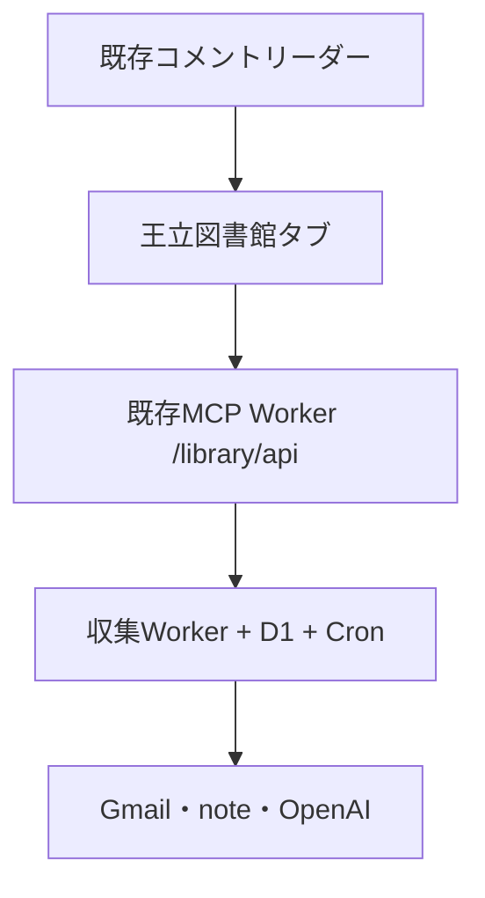

# ネロ王立図書館レコメンドシステム 🌙

メンバーの記事発掘 → 魅力の確認 → 紹介文・コメントの下書き → 掲載履歴の記録を行う、王子専用の管理画面です。既存コメントリーダーの「王立図書館」タブでそのまま利用します。サイトへのログインはありません。

## できること

- Gmailの通知から入会・退会・プラン変更を同期。アカウントやプランが不明な通知は確認待ちへ
- 会員名、note ID・URL、Discord名、タグ、優先度、入会日、状態を編集
- 日本時間6:00 / 18:00に記事収集を開始。記事単位で保存・再試行
- 公開本文、スキ・コメント、タグ、サムネイル、日時を保存。有料・限定記事は認証なしで読める部分のみ
- AI概要・要約・魅力・良かったところ・おすすめ理由・想定読者・引用候補・約200字の紹介文・5行程度のコメント案
- 週間スキ・コメント・総合ランキング、約7日前とのスキ・コメント増加数と増加率
- 入会順・未紹介から最大6人を選択。おすすめ度からも最大6人。同じ人は1枠
- 最終紹介から30日以上、または未紹介の人を表示
- 掲載した紹介記事のURLを登録すると、紹介履歴と最終紹介日を更新。AI生成・コピーだけでは更新しない
- 朝7:00のDiscordレポート。メンションは無効

## 構成

既存GitHub Pagesの「コメント」「イベント」と並ぶ「王立図書館」タブにReact画面を直接マウントします。別URLの入力・別窓・iframe・サイトログインはありません。CSSはShadow DOMで分離し、コメント画面の見た目や動作と干渉させません。Next.jsの画面コンポーネントをTypeScript / Tailwindとともにビルドして既存サイトに同梱します。

ブラウザは従来のMCP Workerの `/library/api/*` にアクセスします。MCP Workerは `LIBRARY_API` Service bindingで収集用Workerに転送します。追加のフロントエンドサイトやPagesプロジェクトは作りません。



`src/domain.ts` が型・スコア・引用検証、`ports.ts` が契約、`application/` が推薦・収集処理、`infrastructure/` がD1と外部API、`worker.ts` がHTTP・Cronを担当します。`web/entry.tsx` がタブのマウント、`scripts/build.mjs` が既存サイトとの一括ビルドを担当します。

## ローカルセットアップ

Node.js 24を使用します。

```sh
cd recommend
npm ci
cp .dev.vars.example .dev.vars
npm run build
npm run db:local
npm run dev
```

`http://localhost:8787` を開き、「王立図書館」を押します。Gmail等を未設定でも会員の手動登録と管理画面は使えます。Gmail自動同期にはサーバー側の接続情報が必要です。

Dockerは `.dev.vars` を用意してから `docker compose up --build`。ローカルDBはvolumeに保存します。

## 本番セットアップ

1. `npx wrangler login` でCloudflareへログイン。
2. `npx wrangler d1 create nero-library` でD1を作成し、database_idを `recommend/wrangler.jsonc` に設定。
3. 同ファイルの `APP_ORIGIN` を既存サイトのオリジン `https://neronote100.github.io` に設定（リポジトリパスと末尾スラッシュは付けない）。`SITE_URL` は `https://neronote100.github.io/nero_comment_reader/` に設定。
4. `MEMBERSHIP_NAME` と `GMAIL_FROM` を実通知に合わせて確認。
5. Gmailを自動取得する場合、Google Cloud ConsoleでGmail APIを有効にし、`https://www.googleapis.com/auth/gmail.readonly` のリフレッシュトークンを取得。Google OAuth Playgroundを利用する場合は自分のOAuthクライアントを使い、offlineアクセスを許可する。これはGmail API用の初回接続で、サイトへのログイン機能ではありません。テスト公開中のトークン失効時はSecretsを更新します。
6. 接続情報をサーバーに設定し、収集Workerと既存MCP Workerを配置:

```sh
cd recommend
npm ci
npm run build
npm run db:remote
npx wrangler secret put GOOGLE_CLIENT_ID
npx wrangler secret put GOOGLE_CLIENT_SECRET
npx wrangler secret put GOOGLE_REFRESH_TOKEN
npx wrangler secret put OPENAI_API_KEY
# Discordを使う場合のみ
npx wrangler secret put DISCORD_WEBHOOK_URL
npx wrangler deploy
cd ../mcp
npx wrangler deploy
```

既存MCP Workerの `LIBRARY_API` は `nero-library-api` を指します。図書館Workerは直接公開せず、既存MCP経由で呼び出します。フロントは既存の `Deploy GitHub Pages` ワークフローがビルド・配置します。図書館用のURL設定・Googleログイン・パスワード入力はありません。

Gmailの認可情報やAPIキーはWorkers Secretsのみに保存し、静的JSや公開JSONへ埋め込みません。GitHubへのコード反映だけではWorkerとD1は更新されないため、初回だけ上記の設置が必要です。

## 定期処理・費用・運用

- Cronは1分ごと。JST 6:00 / 18:00に収集予約、6:50 / 18:50に未分析の候補を予約、7:00に通知。UTC変換はコード内で行います。
- ジョブは毎回最大6件。1ジョブは記事本文1件、一覧1ページ、Gmail最大2通（プロフィール転送は1通あたり最大2回）、またはAI1記事。IDで重複を防ぎ、原子的リース取得・5分期限・最大3回再試行を使います。
- 初回は全記事のバックフィルです。人数と記事数によっては数時間以上かかります。6:00は取得開始時刻で、全件の完了時刻ではありません。朝レポートはその時点で収集済みの候補を使用します。
- 一覧は1会員200ページまで。ダッシュボードの記事表示は新しい順2,000本まで。D1の本文自体は残ります。上限に達した場合は設計・クエリを拡張してください。
- スナップショットはUTC日付で1記事1日1行、90日保持。7日前以前・9日前以後の最も近い記録と比較。初回は増加率未計測。基準が0の場合、増加数は表示し、増加率は未算出。
- 閲覧数は公開APIから取得できないため未対応。コミュニティ活動は共同企画参加フラグを管理者が設定。コメント本文は収集せず、「交流が活発」とAIに推測させません。
- AI評価は0〜5。総合は `スキ + コメント×3 + AI評価×20 + 共同企画参加×30 + 王子お気に入り×100`。優先度は候補選択時の並びに使用し、スコア式に混ぜません。
- `AUTO_AI_LIMIT` は朝夕それぞれの自動分析上限（既定6、最大20、0で停止）。同じ本文は保存済み分析を利用。AIにはタイトル・公開本文の先頭24,000文字と公開範囲だけを送信し、Gmail・Discord名などは送信しません。
- OpenAIはAPI利用料が別途必要です。Workers / D1のプランによる制限と使用量を監視してください。無料枠での運用を保証しません。
- noteは非公式公開APIを使用するため、仕様変更や429で取得に失敗する場合があります。失敗は状態を消さずジョブ履歴に残します。取得不能になった記事の過去キャッシュは残るため、紹介前はnote原文を確認してください。
- メール通知が届かない・通知設定を変更した場合はGmailだけでは会員状態を完全には再現できません。入会日・会員状態は管理画面で修正できます。再入会時も入会順は初回入会日を保持します。
- Discordは当日成功後の再送を避けます。配信成功直後の保存失敗や同時実行時は重複する可能性があり、厳密な一度だけの配信保証はありません。エラーは連携画面に表示されます。

## 接続情報の扱い

サイトのログイン・Cookie・セッションは使用しません。ブラウザのAPIリクエストは `credentials: omit` で送ります。Gmailのリフレッシュトークン・クライアント情報・OpenAIキー・WebhookはWorkers Secretsに置きます。データの更新は既存サイトのOriginから受け付けます。これはログイン認証ではありません。

## 検証

```sh
cd recommend
npm run check
npx wrangler d1 migrations apply nero-library --local
cd ..
node mcp/test.mjs
node mcp/fast-sync.test.mjs
node members/test.mjs
```

GitHub Actionsの `Royal library checks` が同じ検証を実行します。フロントは既存のGitHub Pagesワークフローで更新します。WorkerとD1の自動デプロイは設定していません。セットアップに必要な外部アカウントの設定・Secrets登録後に、Gmail接続・実通知メール・note・OpenAI・Discordの受入確認を行ってください。

設計は [DB・ER](docs/database.md)、[API](docs/api.md)、[画面と要件対応](docs/screens.md) を参照。

実装の参照資料: [Next.js静的出力](https://nextjs.org/docs/app/guides/static-exports)、[Pages bindings](https://developers.cloudflare.com/pages/functions/bindings/)、[D1 prepared statements](https://developers.cloudflare.com/d1/worker-api/prepared-statements/)、[Google OAuth](https://developers.google.com/identity/protocols/oauth2/web-server)、[OpenAI Structured Outputs](https://developers.openai.com/api/docs/guides/structured-outputs)。
