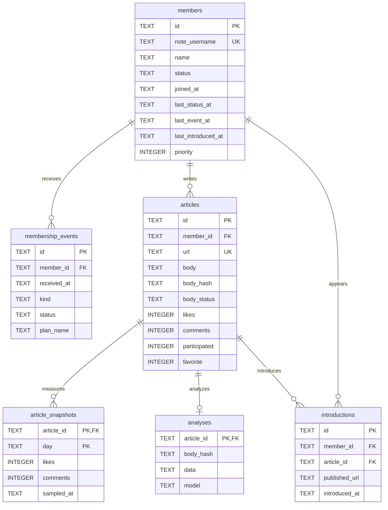

# DB設計・ER図

D1 / SQLite。本文・Gmail通知・会員情報を公開JSONとして書き出さない。すべての日時はISO 8601 UTC。画面とスケジュールは日本時間。スキ・コメントは非負整数。AI評価は0〜5。

| テーブル          | 用途・制約                                                                                                                    |
| ----------------- | ----------------------------------------------------------------------------------------------------------------------------- |
| members           | 会員ID、名前、note ID/URL、Discord名、タグJSON、優先度0〜100、active/withdraw/pending、受信日、初回入会日、最終紹介日、プラン |
| membership_events | Gmail message IDで重複排除。通知種別join/withdraw/plan/unknown。ready/pending/applied。メール本文は永続保存しない             |
| articles          | noteキーをPK。公開部分本文最大100,000文字。public/preview/unavailable。本文ハッシュでAI失効判定                               |
| article_snapshots | 記事ID＋UTC日付を複合PK。日内の最新測定に更新。90日保持                                                                       |
| analyses          | 1記事1行。概要・要約・魅力・良かったところ・推薦・想定読者・紹介案・コメント・引用・0〜5評価をJSON保存                        |
| introductions     | 掲載URLごとの紹介履歴。members.last_introduced_atと同一transactionで記録                                                      |
| jobs              | 固有ジョブID、種別、対象JSON、状態、試行回数、再開時刻、リース期限、エラー。完了は30日保持                                    |
| settings          | 同期日時、通知日時、通知成功日、通知エラー                                                                                    |

入退会とプランの順序を分離するため `last_status_at` と `last_event_at` を持つ。新しいプラン通知が先に到着しても、あとで取得した古い入会通知が失われない。会員状態は `last_status_at` が新しい通知でのみ変更する。初回入会日は最小の入会通知日時。管理者が状態を変更した場合は変更時刻を優先する。

分析・本文・履歴には外部キーを設定。通知からの会員更新、本文＋スナップショット、履歴＋最終紹介日の更新はD1 batchのtransactionを利用する。ジョブは単一UPDATE…RETURNINGで原子的に取得する。

完全な定義は [0001_library.sql](../migrations/0001_library.sql)。初期構築用の追加DBであり、既存Durable Objectsやコメントデータの移行は不要。

サイト認証用テーブルは作りません。Gmail接続情報はWorkers Secretsに置きます。
